<div align="center">


### Find jobs. Rank them. Apply.

PIPeline is a job-search app that runs on your own computer. Pip, a pixel-art
fox, searches Israeli job boards, employers' career pages and Telegram channels,
reads every posting, scores it against your profile, and writes a one-page CV
for the jobs worth sending. You use it in Hebrew or English, on the computer or
from your phone.

<a href="https://pip-site-production-8fff.up.railway.app"></a>


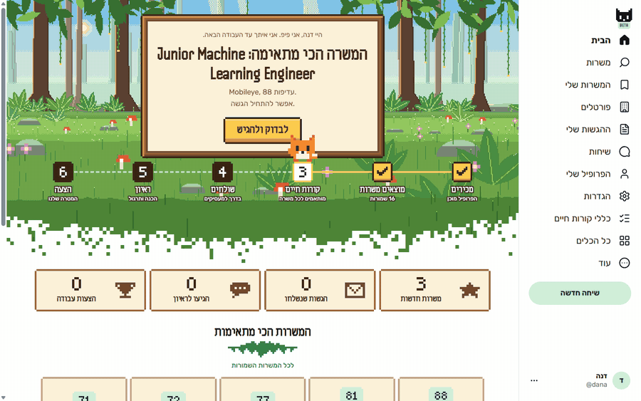

<i>Recorded straight from the running app with made-up data: home, a job's own page, the AI's score arriving, the profile.</i>

</div>

---

## What it is

Everything runs on your machine. A small Bun server serves a React interface,
keeps your profile, CVs and job list in a `user/` folder that is never
committed, and talks to the AI through your own subscription: Claude through
the **Claude Agent SDK**, or ChatGPT through OpenAI's Codex. Your data stays on
your computer; even the phone-access site only passes requests along.

Once a day Pip searches AllJobs, Drushim, JobMaster, LinkedIn and freehire,
20 more boards and career sites (4 read directly, 16 through web search),
9 Telegram channels of job posts, and the employers' career pages it discovers
on its own. It reads each posting the way a crawler
would, with no AI, and leaves out what doesn't fit your search before a single
AI call is spent. The rest it ranks with one call each, and for the best few
it builds a CV in LaTeX, checks that it fits one page, and emails it to you.
An installer for Windows and macOS sets everything up and updates itself, and
a small site on Railway lets your phone reach Pip at home.

The stack is TypeScript on Bun 1.4 throughout: React 18 on the front, a Bun
HTTP server with server-sent events on the back, Python 3 tools for fetching,
guarding and keeping the job list, LuaLaTeX for the CVs, and an Inno Setup
installer with a C# tray launcher.

## Finding jobs

<table>
<tr>
<td width="50%">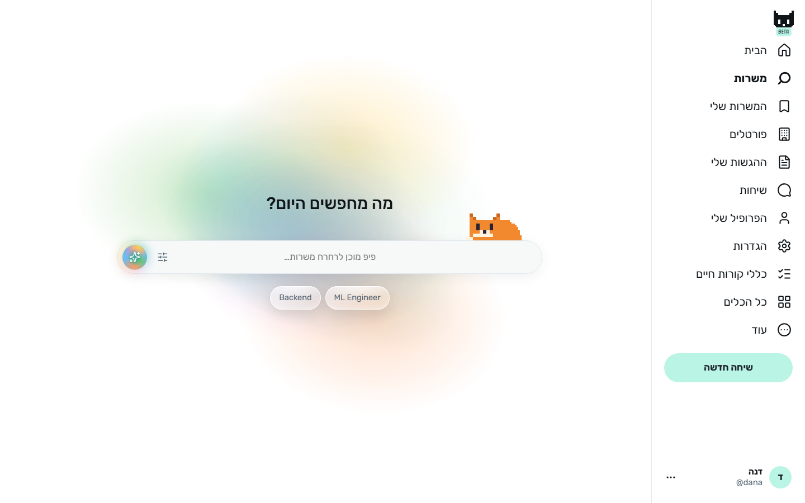</td>
<td width="50%">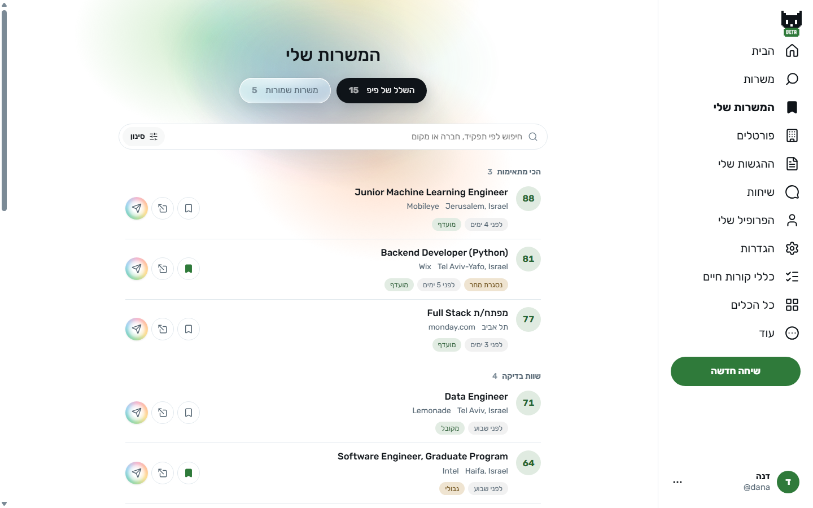</td>
</tr>
<tr>
<td align="center"><b>Search in plain words.</b> Type a role or pick one of
yours, and Pip searches the boards and career pages for it. The sparkles
button starts the smart search, where the AI looks further and judges what it
finds.</td>
<td align="center"><b>Everything Pip found, sorted by fit.</b> Scores from 0
to 100 in groups: the best fits, worth a look, less fitting, not scored yet,
and filtered out for the place, the language or a level above yours.</td>
</tr>
</table>

## A page for every job

<table>
<tr>
<td width="50%">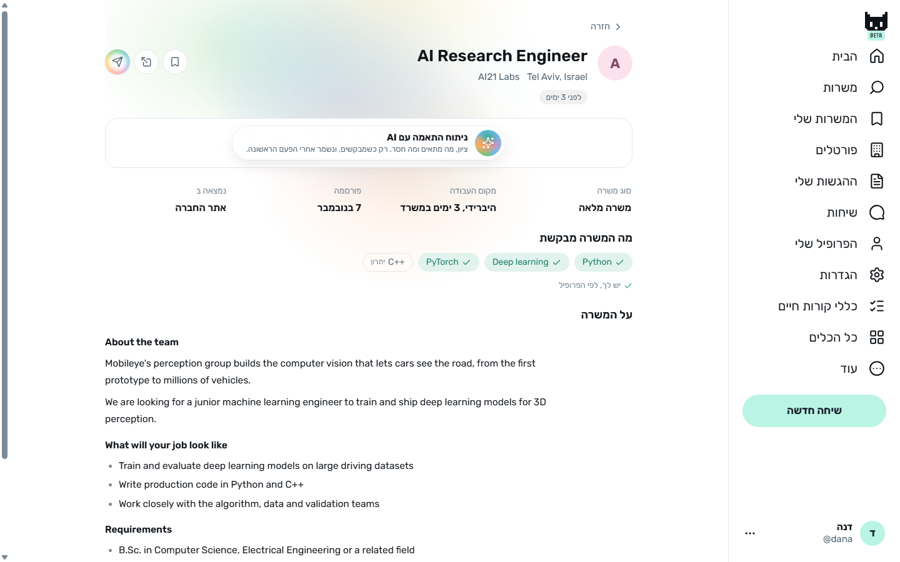</td>
<td width="50%">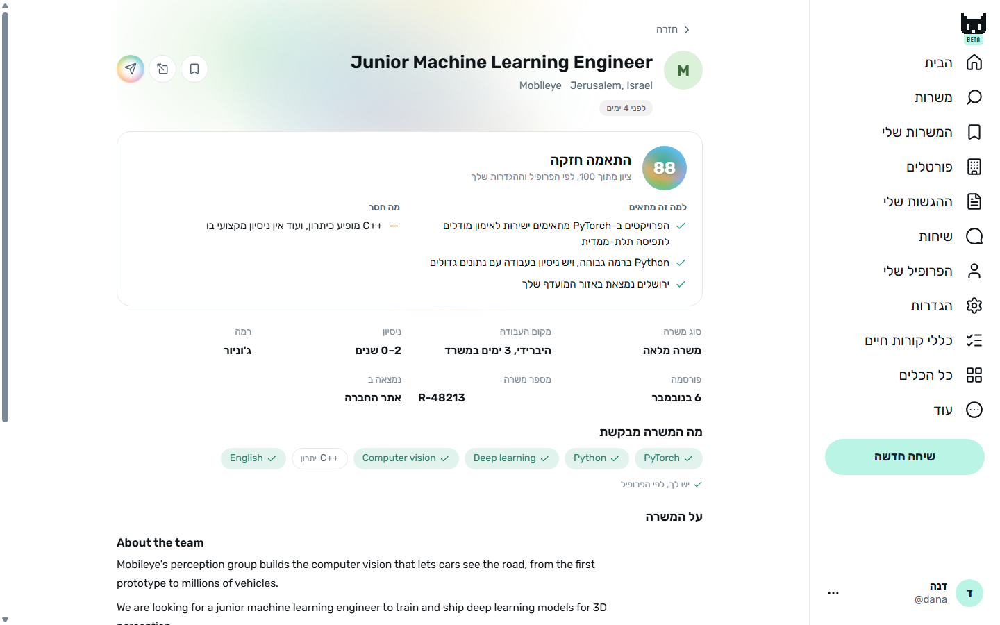</td>
</tr>
<tr>
<td align="center"><b>Read like a crawler, no AI.</b> Opening a job reads its
page: the posting under its own headings, its facts (the kind of job, office
days, the years it asks for) and the skills it names, ticked where your
profile has them.</td>
<td align="center"><b>The AI only when you ask.</b> One call scores the job
against your profile, says why it fits and what's missing, and is saved, so
opening it again costs nothing.</td>
</tr>
</table>

<div align="center">
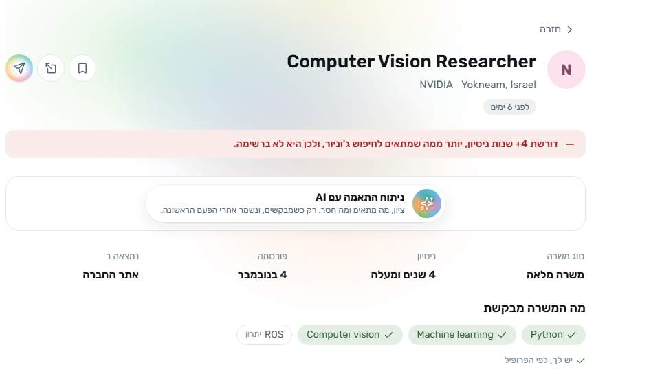
<br>
<i>A junior search never shows a job asking for three years or more. Pip reads
the years from the posting itself, in English or Hebrew, and moves the job out
of the list.</i>
</div>

## Your profile

<table>
<tr>
<td width="50%">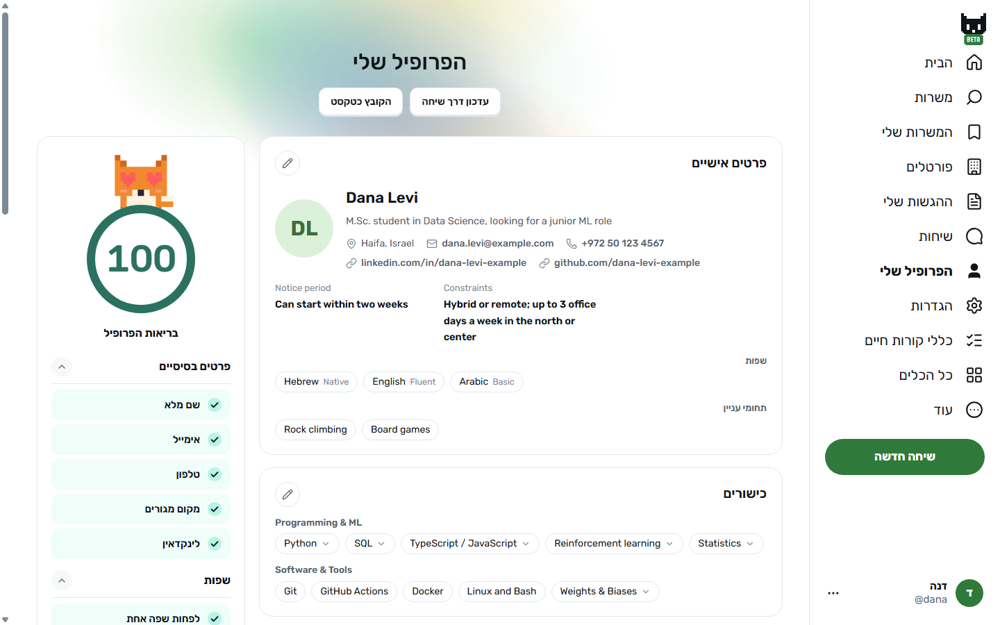</td>
<td width="50%">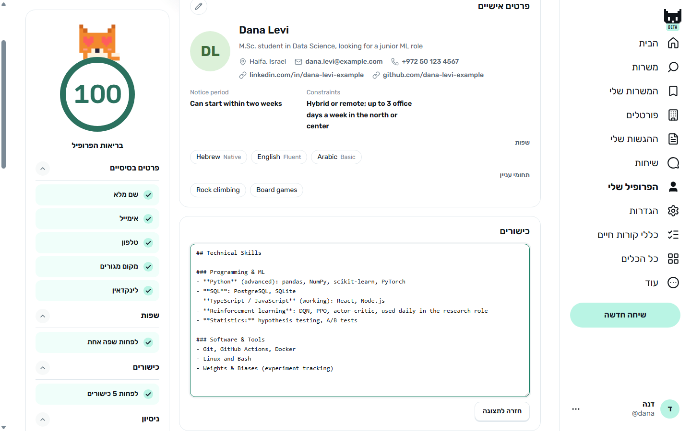</td>
</tr>
<tr>
<td align="center"><b>Your profile, as cards.</b> They are built from the one
Markdown file every CV is written from, with a profile health score out of 100
and the check behind each point.</td>
<td align="center"><b>Edit any part in place.</b> The pencil opens that card's
part of the file as text, and it saves itself a second after you stop
typing.</td>
</tr>
</table>

## Home, chat and your portfolio

<table>
<tr>
<td width="50%">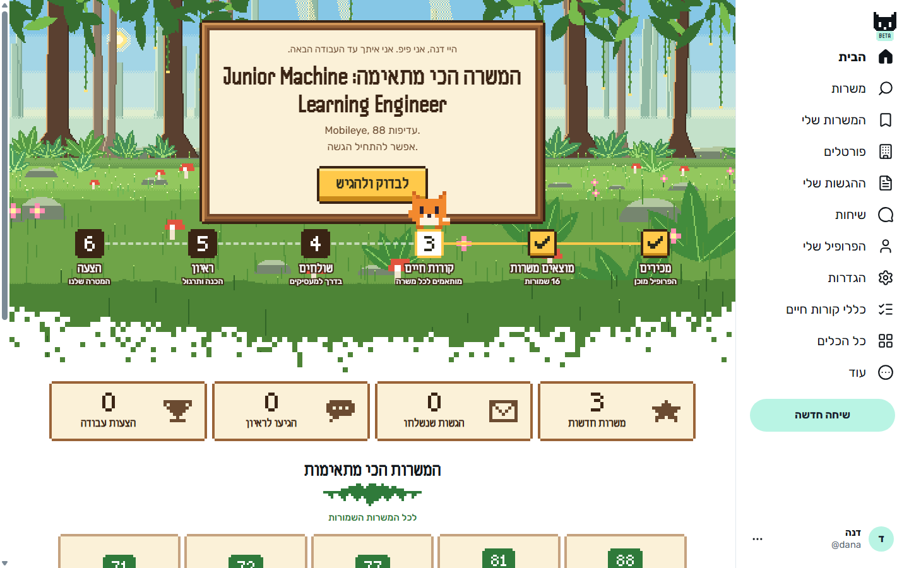</td>
<td width="50%">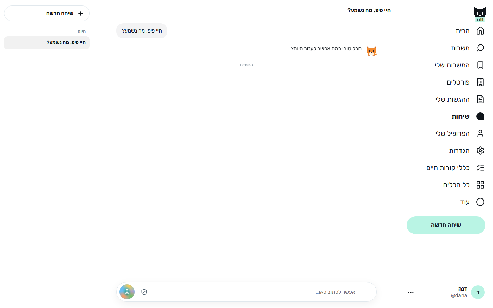</td>
</tr>
<tr>
<td align="center"><b>The next step, on a pixel-art board.</b> The home page
walks you along six stations, from setting up to an offer, with Pip standing
where you are.</td>
<td align="center"><b>Talk to Pip.</b> Conversations run the same Claude Code
commands as the terminal (<code>/apply</code>, <code>/interview</code>,
<code>/setup</code> and the rest), with voice typing in Hebrew or English.</td>
</tr>
</table>

<div align="center">
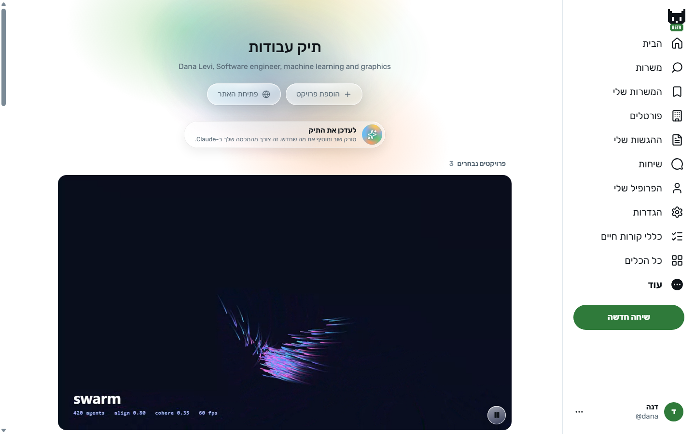
<br>
<i>Pip scans your GitHub and your project folders, picks what is worth
showing, writes a case study for each, and can build a portfolio site.</i>
</div>

## In your pocket

<div align="center">

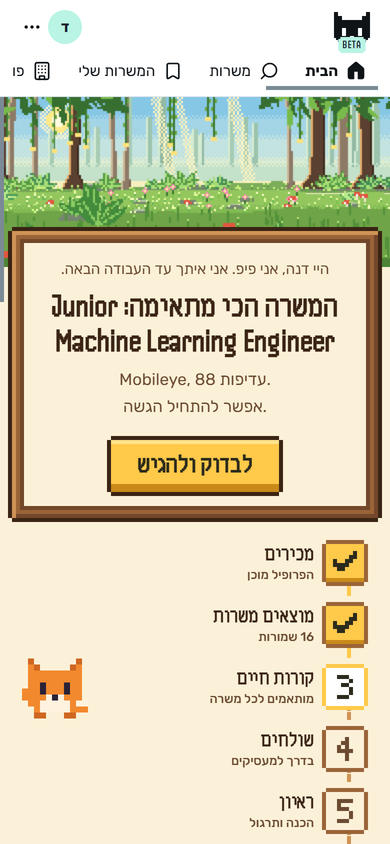
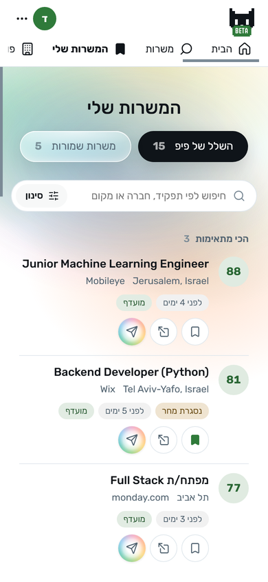
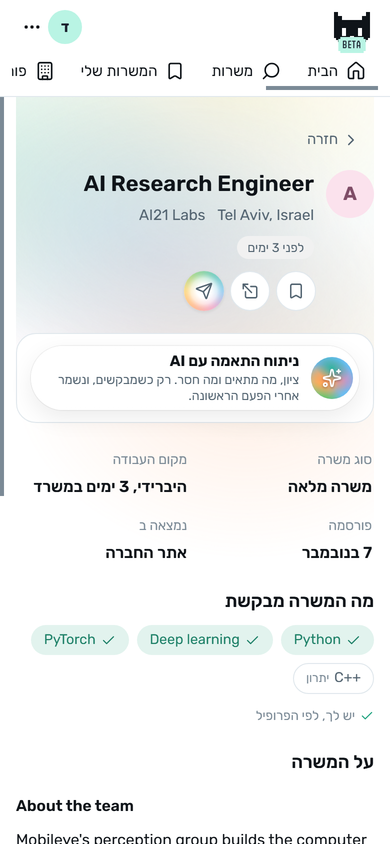
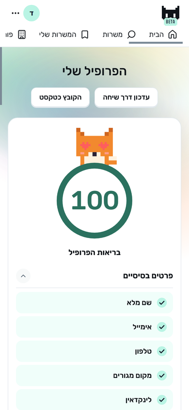
<br>
<i>Sign in from a phone and use the whole app. Every request goes through the
site to your computer, which keeps everything.</i>
</div>

## How it works

<details>
<summary><b>From a link to a posting, with no AI (the crawler)</b></summary>
<br>

```text
link ─▶ fetch_page.py ─▶ the site's own data, or the page ─▶ posting_guard.py ─▶ lines with ## and • ─▶ facts, years, skills
```

1. **Fetch.** `tools/fetch_page.py` downloads the page. LinkedIn and freehire
   jobs come through their own command-line readers instead, and a Telegram
   post through its embed.
2. **Prefer the site's own data.** `web/posting-read.ts` looks for a
   schema.org `JobPosting`, Comeet's position data, Greenhouse's public API
   and Apple's router data before falling back to the page's text, because
   those carry the posting without the site's menus.
3. **Guard it.** `tools/posting_guard.py` removes hidden HTML and flags lines
   that read like instructions to an AI. With `--marks` it keeps headings as
   `## ` and list items as `• `, so the page can show the posting under its
   own headings.
4. **Read the facts from the words.** `web/experience.ts` finds the years the
   posting asks for. `web/posting-words.ts` finds up to 12 skills from a list
   of 103, marks each as required or an advantage by the line or heading it
   sits under, and reads the kind of job, the work mode and the office days.

**Worked example** (from `web/postings.test.ts`). An 11-line page with
"Hybrid: 3 days a week in the office", "2+ years of experience with Python",
"SQL", and "Airflow" under a "Nice to have" heading gives a hybrid job with 3
office days, 2 years asked, and the chips Python and SQL (required, both in
the profile) and Airflow (an advantage). No AI was called.

</details>

<details>
<summary><b>From a posting to a score (the ranking)</b></summary>
<br>

```text
posting ─▶ one AI call ─▶ 4 scores and 2 gates ─▶ weighted total ─▶ band ─▶ rank_state.py ─▶ the list
```

The posting is wrapped between two random marker lines and labelled untrusted
data, then scored against your profile and search settings on four
dimensions:

| Dimension | Weight |
|---|---|
| Technical | 30% |
| Experience | 25% |
| Behavioral | 15% |
| Career | 30% |

Two gates can veto a job whatever its score: **location** (your preferred,
acceptable, borderline and excluded areas) and **language** (a language you
don't list). The total falls into a band:

| Score | Band |
|---|---|
| 75 and up | Strong fit |
| 60 to 74 | Good fit |
| 45 to 59 | Moderate fit |
| 30 to 44 | Weak fit |
| below 30 | Poor fit |

**Worked example.** Scores of 80, 70, 60 and 75 give
`0.30 × 80 + 0.25 × 70 + 0.15 × 60 + 0.30 × 75 = 24 + 17.5 + 9 + 22.5 = 73`,
a good fit. `tools/rank_state.py apply` writes it into the list.

</details>

<details>
<summary><b>Leaving out what a junior shouldn't see (the years filter)</b></summary>
<br>

```text
posting ─▶ each line ─▶ skip the advantages ─▶ years asked ─▶ the most asked ─▶ 3 or more on a junior search ─▶ filtered
```

1. **Read every line.** `web/experience.ts` matches "3-5 years", "4+ years",
   "at least 2 years", "5 years of experience", "3+ שנות ניסיון", "ניסיון של
   שנתיים" and number words, in English and Hebrew.
2. **Skip what isn't a requirement.** Lines that call something an advantage,
   a plus or preferred (or "יתרון") don't count, and neither do years over 15,
   which are a company's age.
3. **Take the most asked.** "5+ years in software, 2+ in Python" asks for
   five.
4. **Check the title too.** Senior, lead, principal, staff, head, architect
   and their Hebrew names count as senior, unless the title also says junior,
   student or intern.

The ranking applies this before its AI call, and a job's page applies it when
it opens. For a junior search, Pip also reads every listed posting in the
background, one at a time, 1.5 seconds apart and at least 5 seconds between
two pages of the same site, so the list knows each job's years. LinkedIn is
never read in the background.

**Worked example.** "4+ years of hands-on experience in machine/deep learning
or computer vision." gives 4 years. On a junior search the job is written to
the list as `filtered` with the reason `years`, appears under "filtered out"
with the chip "דורשת 4+ שנות ניסיון", and costs no AI call.

</details>

<details>
<summary><b>From your profile to a health score (profile health)</b></summary>
<br>

```text
01-candidate-profile.md ─▶ parse into cards ─▶ 12 checks in 6 groups ─▶ round(100 × met / 12)
```

| Group | Checks |
|---|---|
| Basics | name, email, phone, location, LinkedIn |
| Languages | at least one |
| Skills | at least 5 |
| Experience | at least one role, dates for each, points for each |
| Education | at least one |
| Projects | at least one |

**Worked example.** A profile with a name, an email and a degree meets 3 of
the 12 checks: `round(100 × 3 / 12) = 25`, shown in red. At 100 the ring turns
a deep green and Pip's eyes turn to hearts.

</details>

<details>
<summary><b>A phone that reaches your computer (the relay)</b></summary>
<br>

```text
phone ─HTTPS─▶ site on Railway ─▶ the WebSocket your computer opened ─▶ Pip ─▶ user/
```

1. **The computer calls out.** Pip opens a connection to the site when it
   starts, so nothing at home is opened to the internet.
2. **The site only passes requests along.** It keeps each computer's id, its
   account's name and a hash of the key it connects with, in SQLite, and
   one-time pairing codes in memory for two minutes. No passwords and no files.
3. **The computer checks the password.** A phone's sign-in goes through to
   the computer, which holds the account.
4. **Several computers, one account.** Each computer asks the others for the
   account's files and takes whatever is newer, sealed with the account's key.
   A replaced file is kept aside for a week, and files over 40 MB stay put.

</details>

<details>
<summary><b>Install once, update by itself (installer and updates)</b></summary>
<br>

```text
PipSetup.exe ─▶ Bun 1.4.4, Python 3.14.9, MiKTeX 25.12 (each SHA-256 checked) ─▶ tray launcher ─▶ update check every 3 minutes
```

1. **Per-user install.** Inno Setup installs into your own profile, then
   downloads Bun, Python and MiKTeX, each checked against a pinned SHA-256.
2. **A tray launcher.** A small C# launcher starts Pip, opens it in your
   browser and puts Pip's face in the tray.
3. **Updates.** It checks the site 60 seconds after starting and every 3
   minutes after that, waits until Pip isn't busy, verifies the download and
   installs it silently. A page open at the time hides the restart and carries
   on.
4. **macOS.** A one-line install script sets up the same pieces with launchd
   agents and a menu-bar Pip.

</details>

## Run it locally

### Prerequisites

- Windows 10 or 11, or macOS
- [Bun](https://bun.sh) 1.4 or newer
- Python 3.10 or newer
- A TeX distribution with LuaLaTeX (MiKTeX or TinyTeX), for the CVs
- For the AI parts, a Claude plan signed in to Claude Code, or ChatGPT through
  Codex. Without one, everything that needs no AI still works.

Or skip all of this and take the installer from
[the site](https://pip-site-production-8fff.up.railway.app).

### 1. Get it

```bash
git clone https://github.com/seanfourman/PIPeline.git
cd PIPeline
```

### 2. Run it

```bash
cd web
bun install
bun run server.ts
```

On Windows, `start-web.cmd` does both. Open <http://127.0.0.1:4174>. The first
visit walks you through making an account, uploading your CV and setting up
the search, and fills a `user/` folder with your own copies of the profile
templates. `python tools/init_user.py` makes that folder for the command-line
route.

### Settings

| Variable | Default | What it sets |
|---|---|---|
| `JOB_WEB_PORT` | `4174` | Where the local server listens |
| `PIP_SITE` | unset | The phone-access site to pair with; unset keeps Pip on the computer |

Everything else (where to search, your areas, roles, salary, the daily run and
its email) lives on the app's settings page, saved in `user/`.

## Scripts

| Command | What it does |
|---|---|
| `start-web.cmd` | Installs the app's packages and starts Pip (Windows) |
| `cd web && bun run server.ts` | Starts the local server |
| `cd web && bun test` | The app's tests |
| `python -m pytest tests` | The tools' tests |
| `python templates/cv/one-page-clean/build.py <company>_<role>` | Builds one CV, checks it fits one page, and saves the PDF |
| `bun installer/build.ts` | Builds `PipSetup.exe` (needs Inno Setup 6) |
| `bun site/server.ts` | Runs the phone-access site locally, on port 4180 |
| `bun site/deploy.ts --yes` | Deploys the site to Railway (needs the Railway CLI) |

## Commands

The Claude Code commands work in a conversation with Pip or in a terminal
opened in the repository.

| Command | What it does |
|---|---|
| `/setup` | Builds your profile from your CV, LinkedIn export and answers |
| `/apply` | Evaluates a posting, then writes and checks a tailored CV |
| `/rank` | Scores the jobs the search collected |
| `/interview` | Prepares you for a scheduled interview |
| `/expand` | Finds competencies hidden in your documents and public profiles |
| `/outcome` | Records what happened to an application |
| `/gmail-sync` | Reads application updates from your Gmail |
| `/add-portal` | Adds a search skill for another job board |
| `/portfolio` | Picks your best projects and builds a portfolio |
| `/readme` | Writes a README like this one for a project |

## Routes

| Route | Page |
|---|---|
| `/` | Home: the next step and the journey |
| `/jobs` | Searching for jobs |
| `/saved` | My jobs: what Pip found and what you saved |
| `/job/<id>` | A job's own page |
| `/apps` | Your applications |
| `/chat` | Conversations with Pip |
| `/profile` | Your profile |
| `/portals` | The boards and career pages Pip reads |
| `/portfolio` | Your portfolio |
| `/settings` | Search, AI, daily run, phone access |

## API

The local server answers the interface under `/api`, behind the account's
sign-in. The parts, grouped:

```text
State      state, settings, profile, rules, files, file, uploads
Jobs       search, scrape, rank, saved, sources, portals
A job      job/open, job/<id>, job/<id>/again, job/<id>/ai
Applying   applications, ats-terms, checks, transcript
Pip        sessions, automation, portfolio
Setup      intro, ai-login, remote
```

## Architecture

```text
 phone ──HTTPS──▶ site (site/, Railway) ◀──WebSocket── ┐
                                                       │
 browser ──HTTP + SSE──▶ Bun server (web/server.ts) ───┤
      React UI (web/ui)        │                       │
                               ├─▶ user/  profile, CVs, job list, postings (never committed)
                               ├─▶ AI     Claude Agent SDK, Codex (your own login)
                               ├─▶ tools/ fetch_page, posting_guard, rank_state, scrape_state (Python)
                               ├─▶ boards, career pages, Telegram (web/boards.ts, web/portals.ts, .agents/)
                               └─▶ LuaLaTeX (templates/cv/one-page-clean/build.py)
```

### Code map

| Path | What it does |
|---|---|
| `web/server.ts` | The local server: the API, live updates, the daily run, the job list's writes |
| `web/ui/` | The React interface; `views/` holds one file per page |
| `web/postings.ts` | A job's own page: reading it, the AI on request, the background reading |
| `web/posting-read.ts` | Readers for sites' own posting data |
| `web/posting-words.ts` | Skills and work facts from a posting's words |
| `web/experience.ts` | The years a posting asks for, senior titles, the junior filter |
| `web/ranker.ts` | The ranking run and its instructions to the AI |
| `web/boards.ts`, `web/portals.ts`, `web/discover.ts` | Israeli boards, listed career sites and channels, newly found employers |
| `web/scraper.ts` | The smart search |
| `web/agent.ts`, `web/ai.ts`, `web/codex.ts` | Conversations and the AI engines |
| `web/automation.ts` | The daily run and its email |
| `web/auth.ts`, `web/sync.ts`, `web/remote.ts` | Accounts, syncing between computers, the connection to the site |
| `site/` | The phone-access site and its deploy |
| `installer/` | The Windows installer, its tray launcher and the macOS install script |
| `templates/cv/one-page-clean/` | The one-page CV template, its build and its checks |
| `tools/` | Python tools: fetching, the posting guard, the job list's state |
| `.claude/`, `.agents/` | Claude Code commands and skills, the job boards' command-line readers |
| `user/` | Your own data, made from `templates/user/`; never committed |

## Notes

- The installer isn't code-signed, so Windows Defender's cloud check can flag
  it.
- The AI runs on your own Claude or ChatGPT plan, so its limits are your
  plan's.
- The interface and the job sources are built for the Israeli market. The CVs
  are written in English.
- The macOS installer and its menu-bar app have been tested on one Mac.
- LinkedIn is read only when you open or rank a job, never in the background.
- Each computer keeps its own `user/` folder; the site syncs an account's
  files between its computers but doesn't store them.

## Data and credits

- **Built on [ai-job-search](https://github.com/ai-job-search-dev/ai-job-search)**
  by Mads Lorentzen and its contributors (MIT). From it come the Claude Code
  commands and skills (`/apply`, `/rank`, `/setup`, `/interview` and the rest),
  the evaluation framework, the job-list tools (`rank_state.py`,
  `scrape_state.py`, `posting_guard.py`, `fetch_page.py`), the LinkedIn,
  freehire and Danish job-board readers, the cover-letter template and most of
  the Python tests. The name Pip comes from that project's courier-bird
  mascot; this Pip is a fox drawn for this app. Its README is kept in
  [docs/framework-README.md](docs/framework-README.md).
- **humanizer** by Siqi Chen (MIT), unchanged in `.claude/skills/humanizer/`.
- **Fonts:** Rubik, Fredoka and Handjet (SIL Open Font License), through
  Fontsource.
- **Icons:** Lucide (ISC).
- **Common passwords:** the entries of 8 characters or more from SecLists'
  10,000 most common (MIT).
- **AI:** the Claude Agent SDK (Anthropic) and Codex (OpenAI).
- **PDF:** pdf-lib (MIT).
- **Hosting:** Railway, for the phone-access site.

Released under the [MIT license](LICENSE).
